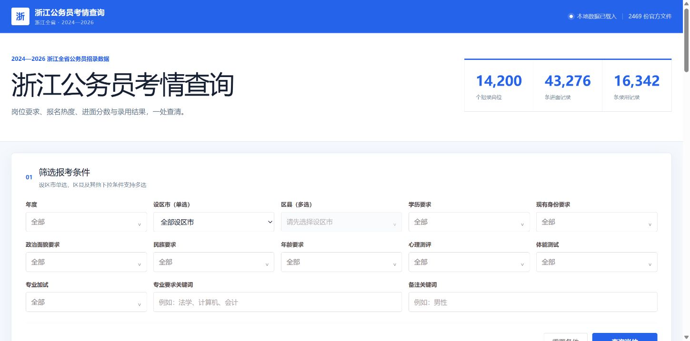

# 岗查查 · 浙江公务员考情查询系统

一个面向浙江省公务员岗位的公开查询工具，将岗位要求、缴费人数、报录比、已收录进面成绩和录用记录关联到同一岗位。支持免登录查询、保存本机筛选方案、岗位对比和 Markdown / CSV 导出；可选由 DeepSeek 解释程序预计算的历史统计。

公开网站：[https://gangcc.sageyak9.chatgpt.site/](https://gangcc.sageyak9.chatgpt.site/)。本地与 GitHub 源码同步至该网站第 5 版功能，包含实名名单展示和前端隐藏内部关联编号。

> [!IMPORTANT]
> 本项目不是浙江省公务员主管部门或浙江省公务员考试录用网的官方产品，仅用于整理和查询历史公开信息。报考资格、招录政策和最终名单请以当年官方公告为准。

## 当前功能与使用流程

网站分为三个页面，查询条件和结果在页面之间保留，浏览器前进、后退可返回相应页面：

1. **报考条件**：选择“按岗位要求检索”或“按本人信息匹配”，设置年度、设区市、区县、专业和资格条件。条件底线提供“全选”和“全不选”，年度及资格条件始终保留。卡片底部的“重置条件”和“查询岗位”用于重设或应用条件，查询后进入岗位明细页。
2. **岗位明细**：阅读招录人数、缴费人数、报录比、岗位要求和备注，查看详情中的来源姓名、成绩和已收录录用记录。岗位内关联编号仅供系统内部匹配，前端不展示。点击“加入对比”，再用表格上方“对比详情”打开弹窗；最多选择 5 个岗位，可在弹窗移除岗位或继续查看详情。
3. **考情与选岗分析**：查看报名竞争、成绩口径和资料覆盖，按证据预览筛选建议；应用或撤销建议会返回岗位明细，预览条件时可返回报考条件。需要 AI 解读时输入自己的 DeepSeek API Key 并主动发起分析。

岗位地图同时位于第 1、2 页顶部，默认展开，可分别收起、展开。地图、列表、统计和导出使用同一已应用查询范围。页面保留“保存已应用方案”和恢复本机方案；已移除收藏、笔记和候选清单导出功能。

专业关键词包含专业不限项和已登记别名；本人信息匹配逐项显示满足、不满足或待确认理由，属于文字初筛。高学历是否可以报考低学历岗位、专业更名及资格包含关系，仍须核对当年政策和招录机关解释。

旧版截图仅用于保留历史界面记录，不代表当前三页布局：



## 数据范围与解释

| 项目 | 数量 |
| --- | ---: |
| 招录岗位 | 14,200 |
| 2024 年岗位 | 5,022 |
| 2025 年岗位 | 5,174 |
| 2026 年岗位 | 4,004 |
| 已关联缴费人数岗位 | 14,106 |
| 进面/总成绩人员记录 | 43,276 |
| 已收录录用人员记录 | 16,342 |
| 原始汇总标注的来源附件数量 | 2,469 |

区域包括浙江省级机关及杭州、宁波、温州、嘉兴、湖州、绍兴、金华、衢州、舟山、台州、丽水 11 个设区市及其下属区、县和县级市。报录比按“缴费人数 ÷ 招录人数”计算，缴费人数不等于实际参加笔试人数。

原始汇总生成日期为 2026-07-27，实际数据截止时间尚未由官方来源确认，不能用生成日期或本次同步日期代替。现有历史汇总保留岗位关联结果及来源相对路径，但官方附件链接、发布日期、原表行号、实际匹配过程和计分依据仍待逐项回查。28 个同岗笔试区间异常仅为待核验线索，不能据此认定原因。

当前成绩类型、满分、科目与折算口径未逐一核实，成绩原值保留展示，不按分布猜测或乘除换算，不据此输出成绩优势和相应综合推荐。成绩缺失、关联失败和待复核分别记录；只有明确官方依据才能标记“未公布”。录用名单完整状态目前未核实，“已收录录用者最低笔试成绩”不是最终录取线。

报名竞争、成绩门槛和资料完整度分别呈现。只有同年度、同考试类别、官方来源确认且计分口径一致，同时达到样本和覆盖要求时，才允许比较成绩及完整综合指数。条件影响与年度一致性描述历史相关，不能解释为独立因果影响或未来录取概率。证据不足时允许不推荐。

来源说明：[浙江省公务员考试录用网](https://gwy.zjks.gov.cn/zjgwy/website/queryMore.htm)及原汇总标注的公开附件；本仓库不包含 2,469 份原始下载附件。原汇总注明部分历史附件存在删除、损坏或格式问题，各岗位缺失原因仍需回查，不能统一归因。

## 本地运行

环境要求为 Node.js 22.13 或更高版本、npm 10 或更高版本；推荐使用项目验证过的 Node.js 24 运行环境。

### Windows 桌面快捷版

本机已有准备好的版本时，双击桌面“岗查查”，或直接双击项目根目录的 `桌面启动.vbs`。入口与后台服务均以隐藏窗口启动。首次创建或修复快捷方式：

```powershell
powershell.exe -NoProfile -ExecutionPolicy Bypass -File .\创建桌面快捷方式.ps1
```

访问地址为 <http://127.0.0.1:43128/>，健康检查为 <http://127.0.0.1:43128/__gangchacha_health>，服务仅监听本机。健康接口保留 `version: 1` 供启动器识别，实际运行版本以 `release` 字段为准。

首次安装依赖或依赖变更后，在项目目录执行：

```powershell
npm ci
```

更新已构建本地版本：

```powershell
powershell.exe -NoProfile -ExecutionPolicy Bypass -File .\更新本地版本.ps1
```

更新脚本校验冻结公开数据并完成构建、运行环境初始化后，写入新的 `.local-runtime` 发行目录，原子切换 `current.json` 指针。失败会保留既有指针，旧发行文件保留。正在运行的服务继续使用旧版，重启本地服务或电脑后加载新版；日常打开不会自动构建或抓取新数据。

本地服务通过 Miniflare 运行 Worker，并以 `.local-runtime/state/d1` 中的持久化 D1 保存 AI 配额和并发租约；库中只存运行计数和随机租约，不存 API Key、筛选条件或名单。发行版切换继续使用相同数据库，请勿清空状态目录重置配额。日志、数据库状态、`.local-runtime`、`work/` 和私人研究资料不提交到 Git。详细说明见[本地快捷启动](docs/本地快捷启动.md)。

也可运行 `npm run build` 后用 `npm start` 直接启动 `dist/` 构建，首次自动初始化本地配额数据库。此方式不依赖 `current.json`，仍只监听本机。其他环境的启动与反向代理兼容性需在部署前验证。

### 开发模式

```powershell
git clone https://github.com/Matt-Ma-C/ZJgkcx.git
cd ZJgkcx
npm ci
npm run dev
```

开发地址通常为 <http://localhost:3000/>，以终端显示为准。`启动系统.cmd` / `启动系统.ps1` 保留为开发入口，与桌面快捷版的 43128 端口和发行目录独立。AI 分析需要可用的 DB 绑定及迁移；缺失配额存储时仅 AI 返回暂不可用，岗位查询继续工作。

仓库中的 `deploy/` 保留既有 Ubuntu/Nginx/systemd 部署资料。本次本地和 GitHub 同步不会自动更新 Ubuntu 服务、DNS、域名或 Sites 项目身份；其他部署环境使用 AI 功能前应核对 Worker、D1 和安全响应头配置。

## 保存、对比与导出

筛选草稿须点击“查询岗位”才生效。已应用标签与未应用修改提示帮助核对范围；保存方案只保存本机非敏感检索条件与底线，本人档案恢复后需重新填写。清除浏览器存储会删除已保存方案。

岗位对比通过岗位明细页的“对比详情”弹窗查看，支持键盘 Escape 关闭及焦点恢复。系统内部继续用岗位内关联标识匹配成绩与录用记录，编号不在页面展示，也不作为官方准考证号使用。

Markdown 与 CSV 导出保留岗位要求、招录及缴费人数、报录比、成绩分布、数据版本与待核验事项，不包含人员姓名、内部关联编号、笔记或 API Key。导出不能使未知或不同计分口径的数据具有可比性。

## DeepSeek 分析与安全边界

先等待程序统计完成，输入自己的 DeepSeek API Key，选择是否考虑公安岗位，再点击开始分析。每次请求绑定已应用条件、岗位 ID 和数据版本；修改已应用范围会取消旧请求或使旧结果失效，支持主动取消和失败反馈。单次最多 15,000 个岗位，接口同时限制正文与返回内容字节数。

**点击分析后，Key 会从浏览器经本站 Worker 转发给 DeepSeek**，用于调用其 API。Key 仅存在当前页面与本次请求处理内存中，不写入项目、数据库、浏览器存储、方案或导出。已应用的筛选快照（包括关键词）、岗位信息和统计结果会一并发送；原始本人档案、人员姓名及内部关联编号不发送。请勿在关键词等输入中填写个人身份信息。DeepSeek 可能按用量收费，请自行确认账户余额和模型可用性。

AI 端点使用共享原子配额和并发租约：每分钟最多 30 次、每天 UTC 计日最多 500 次、同时最多 4 次；请求正文读取期限为 15 秒，上游调用期限为 120 秒。繁忙、配额用尽或存储不可用时返回提示，普通岗位查询和浏览器本地统计不受 AI 限额影响。模型须沿用程序统计口径，可返回“无足够证据推荐”，不得补造政策、分数或资格事实。

AI 输出不加载图片，生成链接仅显示为文字。Worker 加入 CSP 与安全响应头，限制写入入口、同源 JSON 请求、请求体、并发与耗时，并禁用未使用的图片优化端点。这些防护不保证网站完全免受攻击；公开静态数据仍可下载和批量检索。

## 公开名单与数据维护

详情保留来源中的姓名，并按来源状态区分公开、来源已脱敏或来源未提供姓名；系统不猜测缺失字形或姓名。原准考证号、性别和学校/单位字段不发布，内部以岗位内 HMAC 关联标识匹配记录，前端隐藏该标识。姓名不因“前端隐藏编号”而被匿名化。

完整内部原始汇总、匿名关联密钥和原始备份位于被忽略的 `work/data-private/`，不得提交、复制进 `public/` 或上传。公开数据以 **7 个岗位摘要分片、36 个详情分片及目录文件**冻结发布，`jobs.json` 与 `jobs-index.json` 均为目录入口，不能当作完整原始汇总。

```powershell
npm run data:validate
npm run build
```

正常构建只读取已批准的公开数据，用 `scripts/public-data-manifest.json` 校验文件集合、字节数、哈希、岗位顺序、姓名映射和允许披露字段；不读取内部原始备份或密钥，不自动采集新年度。新增数据或修订应单独核验来源、生成分片、更新锁文件并执行测试。

旧 `scripts/build-public-data.mjs` 会生成旧匿名格式，默认拒绝运行。仅供隔离的历史维护副本显式启用；不能用来更新当前实名冻结分片。维护说明和历史审计见[数据维护说明](data-maintenance/README.md)及[数据核验记录](data-maintenance/数据核验记录_2026-10-19.md)。

## 开发与验证

```powershell
npm run data:validate
npm run typecheck
npm run lint
npm test
```

测试涵盖全省岗位覆盖、目录与分片哈希、来源姓名和内部关联、资格三态、计分口径隔离、条件底线、方案恢复、对比弹窗、Markdown/CSV 范围、AI 请求快照、共享配额及安全响应头。准备本地发行版后，可另运行 `node --test tests/local-launcher.test.mjs` 验证桌面服务；未准备时该测试跳过，不会调用真实付费模型。

主要目录：`app/` 为三页界面与浏览器统计，`worker/` 为请求防护和 AI 配额，`db/`、`drizzle/` 为配额表与迁移，`public/data/` 为公开冻结数据，`scripts/public-data.mjs` 为数据校验，`scripts/local-server.mjs` 为桌面运行入口。

## 免责声明

本项目展示历史公开数据及其统计关系，不代表未来招录结果，也不构成报考、就业或法律建议。请在公务员考试研究和个人选岗范围内合理使用，最终报考前重新核对当年官方公告、职位表、资格条件和主管部门解释。
